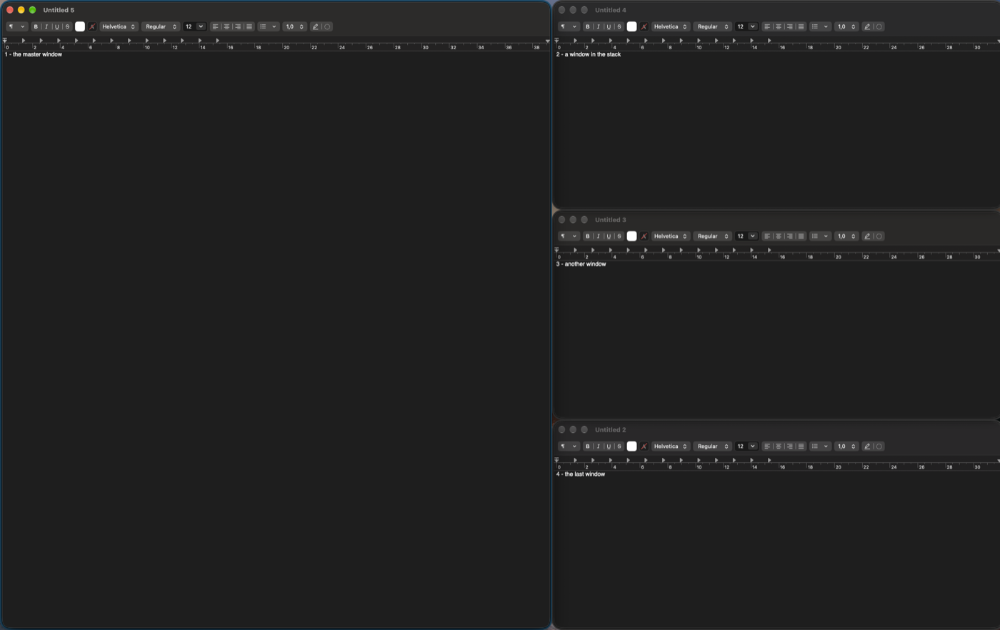
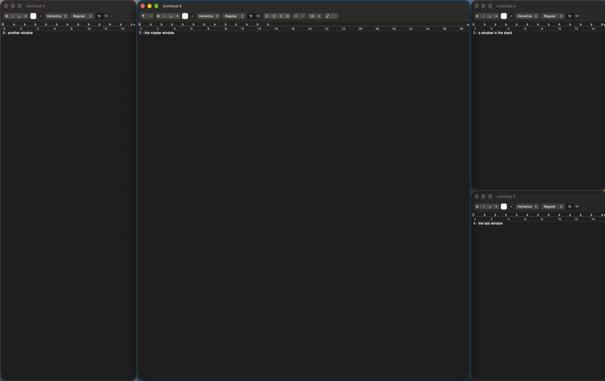
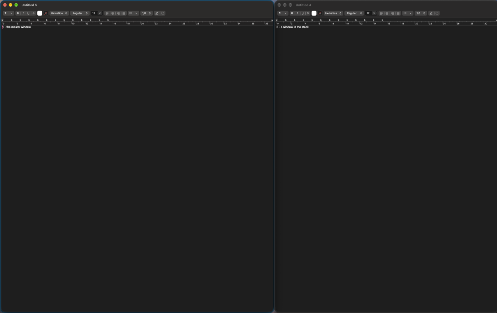
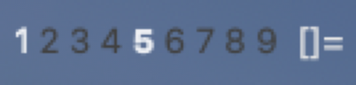
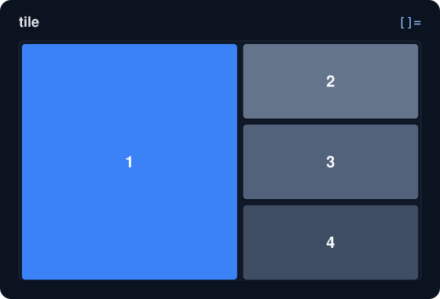
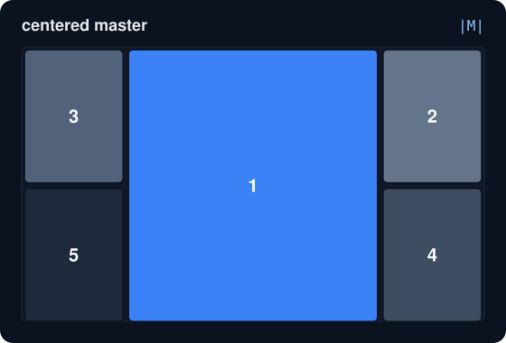
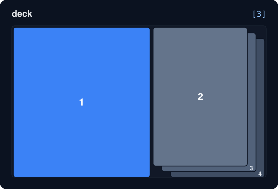
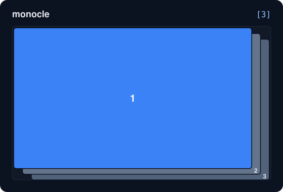

# zwm

**A dwm-style tiling window manager for macOS, written in Zig.**

Tags instead of workspaces, master/stack layouts, a keyboard-driven workflow, and a
configuration that is compiled into the program, as in [dwm](https://dwm.suckless.org/).
It pairs with **[zmenu](https://github.com/skylar2k/zmenu)**, a [dmenu](https://tools.suckless.org/dmenu/)-style launcher that is a
separate project: install it too and Mod + P opens it.

<p align="center">
  
</p>

> **Status: early release (0.1).** It is used daily, but it is young and has rough edges. Read
> [Limitations](#limitations) before relying on it. Apple silicon and macOS only, on purpose.

## Highlights

- **Tags, like dwm.** Nine tags per monitor. A window can be on several tags, and you can
  look at several tags at once.
- **Per-tag layouts.** Every tag remembers its own layout, master size and master count.
  Monocle on tag 2 leaves tag 1 alone.
- **Five layouts:** tile, centered master, deck, monocle and floating.
- **Multiple monitors,** each with its own tags. New windows open on the monitor you are working on
  (the one you last focused), and windows you drag to another display follow.
- **Left and right Option are different keys.** Bind them separately, or use either.
- **A configuration that is checked while compiling.** A typo in a layout name or two bindings on
  the same keys is a compile error with a readable message, not a key that silently does nothing.
- **A menu-bar indicator** for the selected monitor's tags and layout.
- **Sleep, lock and display changes are handled.** It pauses while the machine can't be
  trusted to answer, then re-checks everything on wake.
- **Floating windows are never raised.** zwm doesn't reorder windows you chose to float.
- **Works with [zmenu](https://github.com/skylar2k/zmenu),** the dmenu-style menu and app launcher (a separate project): Mod + P.
- **Small and readable.** About 4,000 lines of Zig (a good part of it comments and tests), with
  unit tests for the logic that doesn't need a screen.

## Screenshots

<table>
  <tr>
    <td align="center"><br><sub>centered master</sub></td>
    <td align="center"><br><sub>deck</sub></td>
  </tr>
</table>

<p align="center">
  <br>
  <sub>the menu-bar indicator: the selected tag is bold, empty tags are dimmed, then the layout symbol</sub>
</p>

## Requirements

- A Mac with **Apple silicon** (the build refuses other architectures).
- **macOS 13 or newer** is the declared minimum. It was developed and tested on macOS 27.2;
  older versions are untested.
- **[Zig](https://ziglang.org/) 0.17.0.** The build uses 0.17's build API.
- The Xcode command line tools (`xcode-select --install`), for the macOS SDK headers.
- The **Accessibility** permission (zwm asks for it on first start).

## Install and first run

```sh
git clone https://github.com/skylar2k/zwm.git zwm
cd zwm
zig build                    # builds zig-out/bin/zwm
zig-out/bin/zwm              # run it
```

On first start zwm asks for the Accessibility permission and waits. Open **System Settings →
Privacy & Security → Accessibility** and switch on the app you started zwm from (Terminal,
iTerm, Ghostty...). It carries on by itself once you do. To quit: **Right ⌥ + Shift + Q**, or
use the menu-bar item. Quitting puts every window back where it can be seen.

The first `zig build` copies `config.def.zig` to `config.zig`. That copy is yours to edit; it is
never overwritten.

## Keys

The default modifier is the **right Option key (⌥)**, written **Mod** below. (Change `MODKEY` in
`config.zig`; see [Configuration](#configuration).) Key names are physical key positions, so
they are the same on every keyboard layout.

| Keys                              | What it does                                               |
| --------------------------------- | ---------------------------------------------------------- |
| Mod + `1`…`9`                     | show that tag                                              |
| Mod + Ctrl + `1`…`9`              | add / remove that tag from what is shown                   |
| Mod + Shift + `1`…`9`             | move the focused window to that tag                        |
| Mod + Ctrl + Shift + `1`…`9`      | add / remove that tag on the focused window                |
| Mod + `0` / Mod + Shift + `0`     | show every tag / put the window on every tag               |
| Mod + `Tab`                       | go back to the previously shown tags                       |
| Mod + `J` / `K`                   | focus the next / previous window                           |
| Mod + `Return`                    | swap the focused window with the master                    |
| Mod + `H` / `L`                   | shrink / grow the master area (5% steps)                   |
| Mod + `I` / `D`                   | more / fewer windows in the master area                    |
| Mod + `T` / `F` / `M` / `U` / `R` | layout: tile / floating / monocle / centered master / deck |
| Mod + `Space`                     | back to the tag's previous layout                          |
| Mod + Shift + `Space`             | float / tile the focused window                            |
| Mod + Shift + `C`                 | close the focused window                                   |
| Mod + `,` / `.`                   | focus the previous / next monitor                          |
| Mod + Shift + `,` / `.`           | send the focused window to the previous / next monitor     |
| Mod + `P` / Mod + Shift + `P`     | zmenu: application launcher / the same, centered           |
| Mod + Shift + `Return`            | open Terminal                                              |
| Mod + `B`                         | show / hide the menu-bar indicator                         |
| Mod + Shift + `Q`                 | quit zwm                                                   |

zwm swallows these key presses, so apps never see them. Holding a key repeats only the
step-by-step actions (focus, resizing the master); it won't repeat _close window_ and the like.

## Tags and layouts

A **tag** is a label, not a place. A window carries a set of tags, and each monitor shows a set
of tags; a window is visible when the two overlap. Switching tags hides the windows that are
not on the new tags. macOS has no way to hide a single window, so zwm parks it just off-screen
and puts it back when its tag returns.

Each tag keeps its **own layout, master size and master count**, per monitor. With several
tags shown at once, the lowest tag's settings apply.

<table>
  <tr>
    <td align="center"><br><sub><code>[]=</code> tile: master left, the rest stacked</sub></td>
    <td align="center"><br><sub><code>|M|</code> centered master: the rest alternate left and right</sub></td>
  </tr>
  <tr>
    <td align="center"><br><sub><code>[k]</code> deck: master left, the rest a pile of k cards</sub></td>
    <td align="center"><br><sub><code>[n]</code> monocle: one window at a time, n in all</sub></td>
  </tr>
</table>

There is also **floating** (`><>`), where zwm leaves positions alone. These diagrams are
generated from the real layout code, with the first window (blue) as the master.

## The menu-bar indicator

An item in the menu bar shows the tags and layout of the **selected monitor**: the selected
tags in bold, tags that hold windows in normal text, empty tags dimmed, then the layout symbol.
It also has a Quit item. `Mod + B` hides or shows it.

## Configuration

Like dwm, the configuration is source code compiled into the program. Edit `config.zig`, run
`zig build`, and restart zwm. Everything lives there: tags, window rules, layouts, gaps, and the
key bindings.

```zig
// The modifier. Mod.lopt = left Option, Mod.ropt = right Option, Mod.opt = either.
const MODKEY = Mod.ropt;

// Tags can start with their own settings (every tag keeps its own afterwards).
pub const tags = [_]zwm.Tag{
    .{ .name = "web", .layout = "monocle" },
    .{ .name = "term", .mfact = 0.7, .nmaster = 2 },
    .{ .name = "3" },
    // ...
};

// Window rules: match by app (bundle id), app name or title.
pub const rules = [_]zwm.Rule{
    .{ .bundle_id = "com.apple.calculator", .floating = true },
    // `.startup = false`: not for windows already open when zwm starts, so a restart
    // does not pull them to tag 9 again.
    .{ .bundle_id = "org.mozilla.firefox", .tags = 1 << 8, .startup = false }, // tag 9
};

// Key bindings. Left and right Option are separate keys:
.{ .mod = MODKEY, .key = .m, .action = .{ .set_layout = "monocle" } },
.{ .mod = Mod.lopt, .key = .n, .action = zwm.sh("open -a Notes") },
```

A binding fires only when **exactly** the listed modifiers are held, so a left-Option binding
does not fire if you also hold right Option. Find a key's code, and see the modifier flags macOS
reports, with `zig-out/bin/zwm --print-keys`.

The config is checked while compiling. For example, `.set_layout = "monocel"` fails with
`a key binding uses an unknown layout: monocel`, and two bindings on the same keys fail with
`two key bindings use the same keys: t`. `config.def.zig` documents every option.

## [zmenu](https://github.com/skylar2k/zmenu)

The default config binds **Mod + P** to `zmenu -a` (an application launcher) and
**Mod + Shift + P** to the same in a centered box. [zmenu](https://github.com/skylar2k/zmenu) is a separate program, a
[dmenu](https://tools.suckless.org/dmenu/)-style menu you can also use on its own and in shell
scripts. Install it, and put it where zwm can find it: next to the `zwm` program, or in
`~/.local/bin`, `/opt/homebrew/bin` or `/usr/local/bin` (zwm looks in all of them, also when
it was started from the app bundle or a login item, which get a minimal `PATH`).

zwm gives every program it starts the variable `ZWM_MONITOR`, the number of the monitor you are
working on (0 = leftmost), so [zmenu](https://github.com/skylar2k/zmenu) opens on the right screen. Without [zmenu](https://github.com/skylar2k/zmenu) installed, the two
bindings simply do nothing; you can bind any other program the same way (see `config.def.zig`).

## Everyday use

```sh
zig build bundle                       # builds zig-out/zwm.app
scripts/login-item.sh install          # optional: start zwm at login
```

- **Run it as an app.** From the bundle (or the login item) macOS gives the Accessibility
  permission to **zwm itself** instead of your terminal. The permission is tied to the app's code
  signature, and the default ad-hoc signature changes with every build, so after rebuilding you
  must enable zwm in System Settings again. A stable signature avoids that:
  `zig build bundle -Dsign-identity="My Certificate"`.
- **Login item.** `scripts/login-item.sh install | uninstall | status | print`. It restarts zwm if
  it crashes, but not when you quit it. `print` shows the launchd file without installing anything.
- **Your windows can't get stuck off-screen.** Quitting (menu, quit key, Ctrl-C or `kill`) puts
  parked windows back. After a Zig panic they are put back before zwm dies, and after any other
  crash the next start pulls any off-screen window back.
- Programs that zwm starts get `ZWM_MONITOR` (the monitor you are working on), and a `PATH` that
  starts with zwm's own folder and includes `~/.local/bin`, `/opt/homebrew/bin` and
  `/usr/local/bin`, so programs installed there are found (see [zmenu](https://github.com/skylar2k/zmenu), above).

## Troubleshooting

```sh
zig-out/bin/zwm --verbose     # or ZWM_LOG=1: log what zwm decides (windows, focus, layouts, timing)
pkill -USR1 zwm               # print a snapshot: monitors, every tag's settings, every window
zig-out/bin/zwm --print-keys  # key codes and modifier flags, including auto-repeat
```

- **Nothing happens / keys don't work:** is the Accessibility permission granted to the app that
  started zwm? It prints a message and waits if not. After rebuilding the app bundle you must grant
  it again (see above).
- **A window won't tile:** dialogs, windows that can't be resized, windows without a fullscreen
  button (settings panes, About boxes), and native full-screen or minimized windows are floating or
  left alone, by design. Add a rule with `.floating = false` to tile one.
- **A popup or panel is being tiled (or should be left alone):** zwm ignores things that are not
  really windows (tooltips, context menus, quick terminals, screen-share pills). If one slips
  through, or you want an app left alone entirely, add a rule with `.ignore = true`.
- **A window you drag snaps back:** a tiled window you move or resize by hand returns to its tile
  when you let go. Dragging it to another monitor moves it there; to keep a window where you put it,
  make it floating (Mod + Shift + Space).
- **An app is frozen:** zwm leaves an app alone for a few seconds after it stops answering, so
  it can't stall everything else.
- **Focus went somewhere unexpected:** `--verbose` logs every focus request and whether macOS
  carried it out.

Debug builds (`zig build`) also check for memory leaks and report them when zwm quits; release
builds (`zig build -Doptimize=ReleaseSafe`) do not.

## How it works

zwm keeps its own model of your windows (which monitor, which tags, floating or tiled) and makes
macOS match it. A few points that explain its behaviour:

- **The only way to move other apps' windows is the Accessibility API**, built for screen
  readers. That is why the permission is needed, and why every change is an IPC call to
  the app that owns the window.
- **Notifications are treated as hints.** macOS's window notifications are late or missing
  often enough that zwm never trusts them: any event just schedules a _reconcile_, which compares
  its list with the real windows and fixes the differences. Events only rescan the app they came
  from, and a slower heartbeat rescans everything as a safety net.
- **Hotkeys come from an event tap.** Unlike the simple hotkey API, it sees which Option key was
  pressed, which is what makes left and right Option separate.
- **Layouts are pure functions** from (area, window count, settings) to rectangles. They know
  nothing about windows, which makes them easy to test and to write.

## Limitations

Please read these before depending on zwm:

- **Apple silicon and Zig 0.17.0 only.** Tested on macOS 27.2 with a notched display.
- **Multiple monitors were tested with two displays that stay connected** (spawning, focusing,
  sending windows, per-monitor tags, dragging). Unplugging, re-plugging and sleep with two
  displays have not been tried.
- **Native tabs** (Terminal, Finder, ...) count as one window: switching tab keeps the window's
  tile, tags and monitor.
- **One Space per display.** Windows on other Spaces are not managed; native full-screen windows and
  minimized windows are left alone. Windows of an app you hide (Cmd-H) give their tiles back until
  the app is shown again.
- **Hiding is parking.** Windows on hidden tags are moved just off-screen (a thin sliver can remain
  at the corner), so they still appear in Cmd-Tab and Mission Control. If an app switch lands on a
  parked window, focus is handed back to a visible one; switch tags to reach it.
- **Some apps refuse to get small.** zwm learns a window's minimum size and lets it be larger than
  its cell, which can make windows overlap.
- **The Accessibility API is slow with large numbers of windows,** and a frozen app can delay
  actions for up to half a second per call (then it is skipped for a few seconds).
- **No mouse bindings, no window borders,** and the menu-bar indicator can't be clicked. macOS
  already moves and resizes windows with the mouse.
- **Option-based shortcuts are taken from apps.** Whichever key combinations you bind are swallowed.

## Project layout

```
LICENSE            GNU GPL v3 (and THIRD_PARTY_NOTICES for the dwm / AeroSpace / zig-objc / Zig notices)
config.def.zig     the default configuration (copied to config.zig on first build)
build.zig          build script: zwm, the app bundle, tests
src/               zwm: window manager, layouts, Accessibility, hotkeys, menu-bar item
scripts/           the login-item installer
resources/         the app bundle's Info.plist
docs/images/       the pictures in this README
```

## Development

```sh
zig build test                       # unit tests: layouts, key matching, per-tag state
zig build -Doptimize=ReleaseSafe     # release build
```

The tests cover everything that doesn't need a screen: layout maths, modifier matching, the
per-tag and per-monitor state changes, and the rules that classify windows.
The centered-master and deck layouts were also compared against the original C from dwm on
thousands of inputs, with identical results.

## License and credits

zwm is free software, licensed under the **GNU General Public License v3** (see
[LICENSE](LICENSE)).

It contains code derived from MIT/X-licensed projects, whose notices are in
[THIRD_PARTY_NOTICES](THIRD_PARTY_NOTICES):

- The layouts (`tile`, `monocle`, `centeredmaster`, `deck`) and the ideas behind tags, master/stack and
  the compiled-in configuration come from **[dwm](https://dwm.suckless.org/)**, by the
  [suckless.org](https://suckless.org/) community.
- **[AeroSpace](https://github.com/nikitabobko/AeroSpace)** was the reference for how to manage
  windows on macOS: parking windows off-screen, finding the focused window, and which Accessibility
  calls to use. The rules that tell popups from windows, and which windows float, and the native-tab
  handling, are ported from its code.
- **[zig-objc](https://github.com/mitchellh/zig-objc)** by Mitchell Hashimoto sends the Objective-C
  messages.
